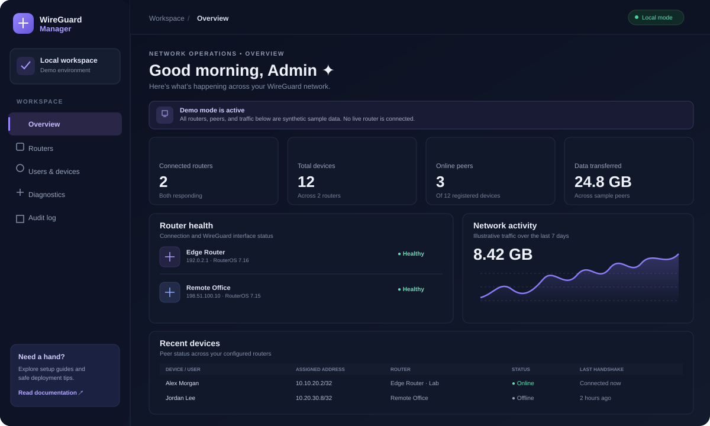
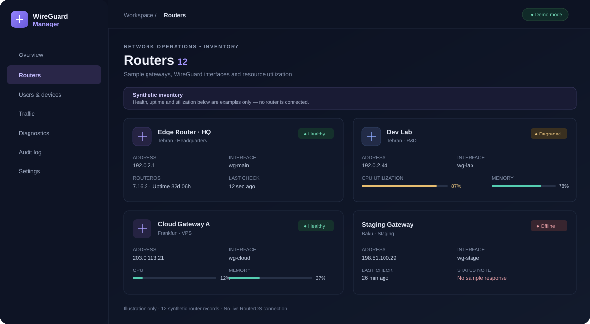
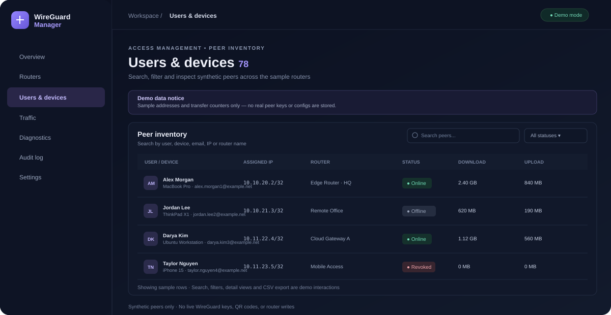

# WireGuard Manager

A dark, responsive **frontend demo for organizing WireGuard routers, peers, device inventory, traffic, diagnostics, and administrative audit events**. Built with React, TypeScript, and Vite.

> [!WARNING]
> **Demo only — not connected to real routers.** All router health, peer status, resource values, traffic, diagnostics, and audit events are illustrative. This project does not connect to MikroTik RouterOS, execute SSH/API commands, create or revoke real peers, or generate WireGuard keys/configurations. Do not use the displayed values as live monitoring data.

<p align="center">
  <a href="https://nestho.github.io/wireguard-manager/"><strong>Open the live demo →</strong></a>
  &nbsp; · &nbsp;
  <a href="https://github.com/nestho/wireguard-manager/actions/workflows/ci.yml"><strong>Build & deployment workflow</strong></a>
</p>

## Screenshots

The screenshots below are **illustrative SVG mockups** of the current interface and its separate views. They contain synthetic data, not live application telemetry.

### Overview dashboard



### Router inventory



### Users and devices



### Traffic, diagnostics, audit log and settings


## Demo pages

Every sidebar section has its own view and hash route. You can open a section directly, refresh it, or use the browser's Back/Forward navigation.

| Section | Route | What's inside |
|---|---|---|
| **Overview** | [Open Overview](https://nestho.github.io/wireguard-manager/#/overview) | Summary metrics, router health, traffic overview, recent peers, and demo-mode notice |
| **Routers** | [Open Routers](https://nestho.github.io/wireguard-manager/#/routers) | Router cards, RouterOS version, interface, location, health status, CPU/memory utilization, uptime, and last-check examples |
| **Users & devices** | [Open Users & devices](https://nestho.github.io/wireguard-manager/#/users-and-devices) | Searchable peer inventory, owner/device details, assigned sample address, router, connection state, last-seen value, and RX/TX usage |
| **Traffic** | [Open Traffic](https://nestho.github.io/wireguard-manager/#/traffic) | Illustrative traffic charts, time-period selector, total transfer, and per-device usage breakdown |
| **Diagnostics** | [Open Diagnostics](https://nestho.github.io/wireguard-manager/#/diagnostics) | Run local demo checks for inventory, interface health, duplicate sample addresses, stale handshakes, and resource thresholds |
| **Audit log** | [Open Audit log](https://nestho.github.io/wireguard-manager/#/audit-log) | Searchable sample events and UI actions recorded during the demo session |
| **Settings** | [Open Settings](https://nestho.github.io/wireguard-manager/#/settings) | Interface preferences, demo data backup/export and reset controls, plus a reminder that no live router is connected |

## Current demo capabilities

- **Seven navigable views** with individual content, headings, and hash routes.
- **Sample inventory:** 12 routers and 78 synthetic device/peer records.
- **Router inventory:** sample locations, interface names, RouterOS versions, health, uptime, CPU, and memory.
- **Peer/device inventory:** search and filters, router association, sample address, status, platform, last-seen, and illustrative RX/TX counters.
- **Demo interactions:** add/edit sample records, toggle a sample device's state, remove demo entries, inspect router/device details, and receive UI notifications.
- **Traffic view:** visual usage summaries and per-device breakdowns derived from the sample dataset.
- **Diagnostics:** simulated checks that report results based on local demo data; they do not probe a router or network.
- **Audit view:** demo actions can add entries to the local audit list.
- **Data portability:** CSV exports for inventory/audit data and a JSON demo-data backup, where offered by the UI.
- **Preferences and local persistence:** supported demo changes and selected interface preferences are stored in the current browser's local storage.
- **Responsive layout:** desktop sidebar and mobile navigation.
- **GitHub Pages deployment:** GitHub Actions type-checks/builds the frontend and deploys the static site on pushes to `main`.

## Try the demo

1. Open the [live demo](https://nestho.github.io/wireguard-manager/).
2. Select **Routers**, **Users & devices**, **Traffic**, **Diagnostics**, **Audit log**, or **Settings** from the sidebar.
3. Use search/filter controls in the inventory and audit views.
4. Open a router/device detail or use the available sample-record actions.
5. Export the displayed sample data if you need to inspect the formats.
6. Use **Settings** to explore demo preferences and reset options.

Because this is a static frontend demo, changes are local to your browser. Resetting browser storage or opening another browser/device may restore the initial seed data.

## Run locally

### Requirements

- Node.js 20 or newer
- npm

### Install and start

```bash
git clone https://github.com/nestho/wireguard-manager.git
cd wireguard-manager
npm install
npm run dev
```

Vite prints the local development URL, usually `http://localhost:5173`.

### Production build

```bash
npm run build
npm run preview
```

The build runs TypeScript project checks before creating the Vite production bundle.

## Project layout

```text
wireguard-manager/
├── .github/workflows/ci.yml    # CI build and GitHub Pages deployment
├── demo/seed-data.json         # Synthetic example fixture
├── docs/
│   ├── dashboard-preview.svg   # Overview screenshot illustration
│   ├── routers-preview.svg     # Router inventory illustration
│   ├── devices-preview.svg     # Users/devices illustration
│   └── operations-preview.svg  # Traffic, diagnostics, audit and settings
├── src/
│   ├── App.tsx                 # Demo views, sample state, and interactions
│   ├── main.tsx                # React entry point
│   └── styles.css              # Responsive dashboard styling
├── index.html
├── package.json
└── vite.config.ts
```

The app currently defines its main demo seed objects in `src/App.tsx`; `demo/seed-data.json` is a separate starter fixture and is not yet the runtime source of truth.

## Current limitations and next milestones

This is a UI prototype, **not yet a RouterOS management product**.

- [ ] Secure backend/API for RouterOS connectivity (SSH or RouterOS API)
- [ ] Authentication, session handling, and role-based authorization
- [ ] Router onboarding and connection testing with safe, read-only defaults
- [ ] Real peer discovery and synchronization
- [ ] Peer creation/revocation with address validation, dry-run preview, explicit confirmation, and rollback
- [ ] Safe private-key/configuration handling and client config/QR generation
- [ ] Server-side persistence, migrations, and reliable backup/restore
- [ ] Live metrics and traffic collection with timestamps and source status
- [ ] Audit trail persisted server-side and protected against tampering
- [ ] Automated unit, integration, accessibility, and end-to-end tests
- [ ] Release packaging and deployment documentation

## Security principles for future live integration

- Never put router passwords, SSH private keys, WireGuard private keys, client configurations, or QR codes in frontend code, screenshots, issues, logs, or demo fixtures.
- Keep demo data clearly separated from real router inventory.
- Use authenticated backend requests; do not connect the browser directly to routers or expose secrets to client-side JavaScript.
- Default to read-only discovery. Show a clear preview before any live mutation.
- Require explicit confirmation for peer creation, revocation, or configuration changes.
- Validate peer addresses and prevent duplicate assignments before applying changes.
- Back up relevant router configuration before writes and document recovery/rollback behavior.
- Treat router responses and imported inventory as untrusted input.
- Label timestamps, stale data, connection failures, and demo/synthetic values unambiguously.

## Contributing

Issues and pull requests are welcome. For bug reports, include steps to reproduce and redacted logs where useful. **Never attach production configuration exports, credentials, private keys, client configs, or QR codes.** Use synthetic examples.

## License

Distributed under the MIT License. See [LICENSE](LICENSE).


## Backend API (early development)

The repository now includes a separate FastAPI service under `backend/`. The frontend demo remains illustrative and is not yet wired to this API.

### Implemented API foundation

- JWT access-token login and a `/me` endpoint.
- Argon2 password hashing and admin/operator/viewer authorization checks.
- Admin-only user provisioning and one-time environment-configured bootstrap endpoint.
- SQLAlchemy persistence models for users, routers, peers, and audit events.
- Encrypted-at-rest router credentials and peer private-key field using a Fernet key supplied outside the repository.
- Router registration, HTTPS/TLS-verified connection testing, and read-only RouterOS REST discovery of WireGuard interfaces/peers.
- Private-address-first router host policy; public hosts are blocked unless explicitly enabled in deployment configuration.
- IP-prefix validation and dry-run peer creation preview.
- Hash-linked audit events and admin audit-chain verification endpoint.
- CI runs backend unit/API tests in addition to the frontend build.

### API endpoints

| Method | Endpoint | Access / behavior |
|---|---|---|
| GET | `/healthz` | Liveness |
| GET | `/api/v1/health` | API readiness |
| POST | `/api/v1/admin/bootstrap` | One-time bootstrap, only when configured and no users exist |
| POST | `/api/v1/auth/login` | Obtain a short-lived JWT access token |
| GET | `/api/v1/auth/me` | Current authenticated user |
| POST | `/api/v1/auth/users` | Admin creates a user and assigns a role |
| GET / POST | `/api/v1/routers` | Authenticated inventory / operator-or-admin registration |
| POST | `/api/v1/routers/{id}/test` | Operator-or-admin HTTPS connection test |
| GET | `/api/v1/routers/{id}/wireguard/peers` | Authenticated read-only peer/interface discovery |
| POST | `/api/v1/routers/{id}/peers/preview` | Validate and preview a proposed peer |
| POST | `/api/v1/routers/{id}/peers` | Deliberately disabled (HTTP 501) pending verified rollback and consistency checks |
| GET | `/api/v1/admin/audit/verify` | Admin verifies the audit hash chain |

### Run the backend locally

Requires Python 3.11 or newer.

```bash
python3 -m venv .venv
source .venv/bin/activate
python -m pip install -e ".[dev]"
cp backend/.env.example .env
```

Generate and configure both secrets before running the service. Do not commit the resulting values:

```bash
python -c 'import secrets; print(secrets.token_urlsafe(48))'
python -c 'from cryptography.fernet import Fernet; print(Fernet.generate_key().decode())'
```

Set the first output as `WGM_JWT_SECRET` and the second as `WGM_ENCRYPTION_KEY` in the protected environment. Configure bootstrap username/password only for initial setup, start the API, then remove bootstrap credentials from the environment after creating the admin.

```bash
uvicorn wireguard_manager_api.main:app --reload --app-dir backend
python -m pytest backend/tests
```

Local API documentation is available at `http://127.0.0.1:8000/docs`. Use a dedicated RouterOS account with minimal permissions and a valid HTTPS certificate. Never disable TLS verification to bypass certificate errors.

### Current backend limitations

This is **not yet a production-ready RouterOS management product**. Peer mutations are intentionally blocked while safe RouterOS-side create/delete, rollback, IP-pool reconciliation, client configuration delivery, and integration tests are unfinished. Refresh-session revocation, rate limiting, formal Alembic migrations, external secret-manager support, tamper-resistant off-host audit retention, live monitoring history, and a deployment hardening review are also outstanding. The API is not connected to the frontend demo yet.

See [CHANGELOG.md](CHANGELOG.md), [SECURITY.md](SECURITY.md), and [backend/README.md](backend/README.md) for release history, security guidance, and backend setup details.
